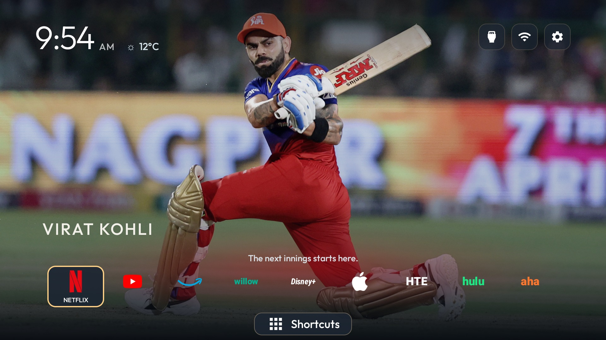
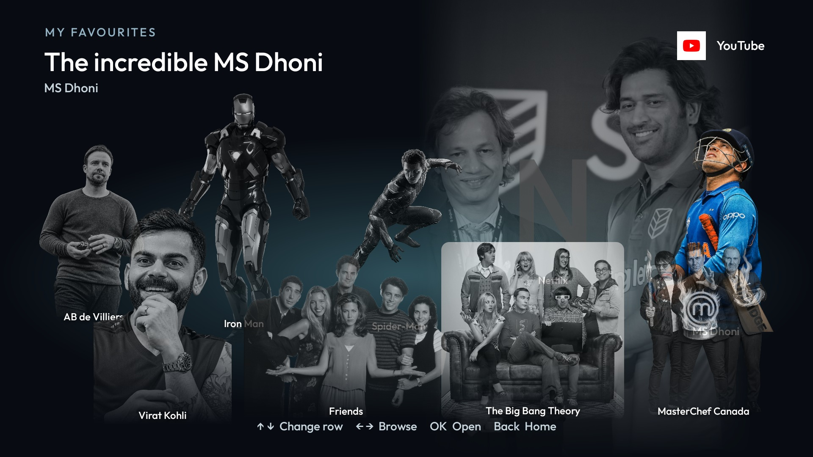
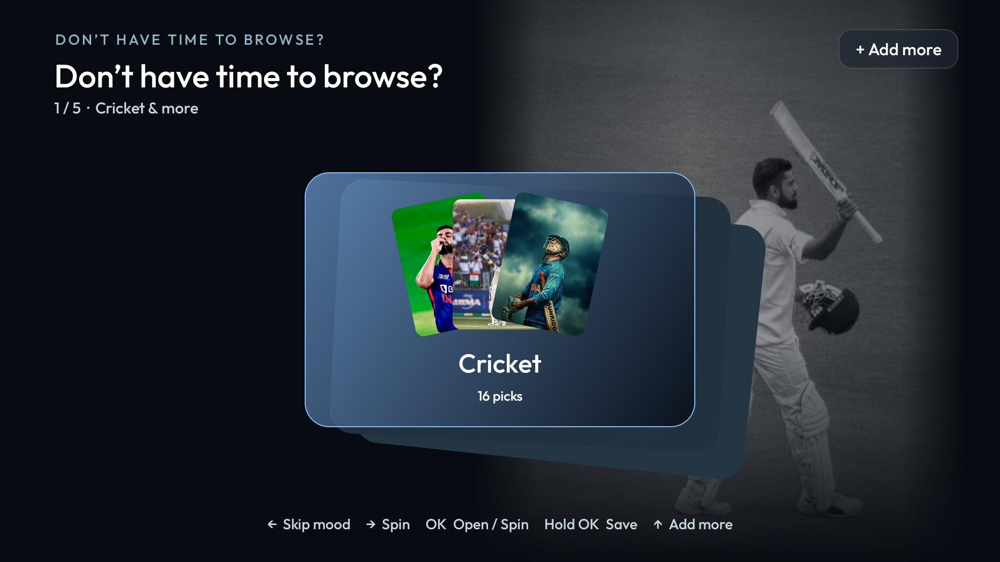
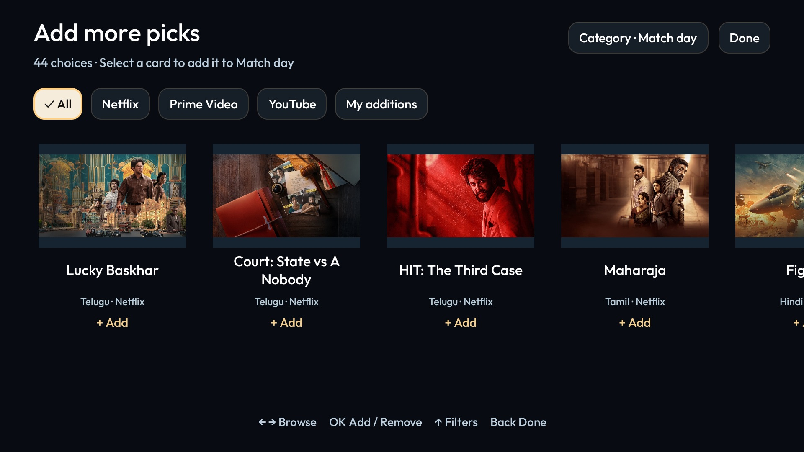
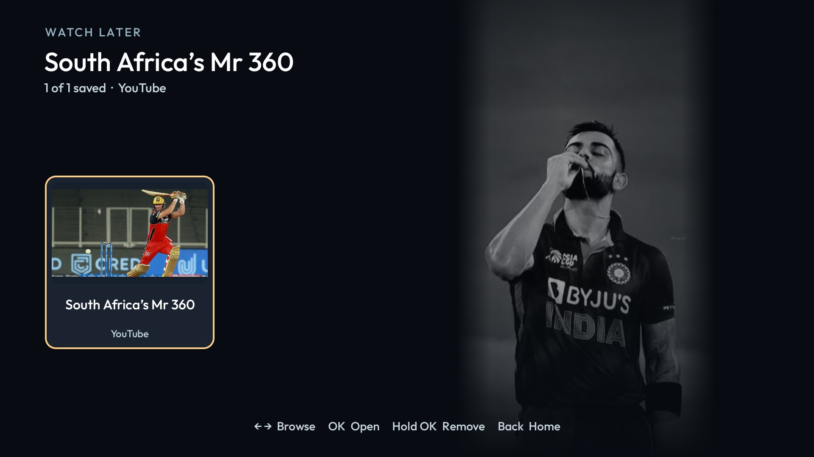

# CleanYourTV

A cinematic Android TV / Google TV home screen with a cricket-inspired theme, character Favourites, a movie and channel picker, Watch Later, and Match Day.

This is a customized derivative of [Gathin23/cleanyourtv](https://github.com/Gathin23/cleanyourtv). The launcher package remains `com.gathin.tvhome`; its on-device theme is called **Cricket Legends**. This repository includes the customized Java source and the original cleanup tools, device examples, themes, and reference documentation.



## See it on a TV

| My Favourites | Pick something |
| --- | --- |
|  |  |

| Browse and add | Watch Later |
| --- | --- |
|  |  |

[Full screenshot gallery](docs/SCREENSHOTS.md) · [Short video tour](docs/media/cleanyourtv-tour.mp4) · [Animated preview](docs/media/preview.gif)

The pictures are real captures of the customized TV launcher. The video and animation are a **screenshot slideshow**, not a live navigation recording. Screenshots represent several development milestones; the feature guide describes the current source.

## Features

- **Home:** rotating artwork, original app colours, clear focus outlines, and a compact Shortcuts button.
- **My Favourites:** two rows of characters and shows; selection reveals colour, themed light, a scene backdrop, and selected audio cues.
- **Pick something:** Cricket, Telugu movies, Hindi movies, YouTube channels, and Anything at all, with artwork and provider links.
- **Add more:** browse the bundled catalogue, filter Netflix / Prime Video / YouTube, choose a category, and add or remove without typing links.
- **Watch Later:** hold OK on a Favourite or picker result to save it; open saved titles or hold OK to remove them.
- **Match Day:** upcoming fixtures from Willow and a shortcut to the Willow app.
- **Remote navigation:** explicit row boundaries, panel-contained focus, and one-level Back behaviour during rapid presses.
- **Optional weather:** disabled in the shared build until you supply your own location locally.

See [features and controls](docs/FEATURES.md).

## Build

Requires **JDK 17**, Android SDK platform **34**, Build Tools **34.0.0**, and Android TV **8.0 / API 26 or later**.

```sh
git clone https://github.com/vamshi4067/CleanYourTV.git
cd CleanYourTV/launcher
# Set JAVA_HOME and ANDROID_HOME for your local installations.
./gradlew --no-daemon testReleaseUnitTest lintRelease assembleRelease
```

Windows: use `gradlew.bat`. The first build downloads Gradle and dependencies. APK: `launcher/app/build/outputs/apk/release/app-release.apk`. Signing keys and prebuilt APKs are not in Git.

Follow [Setup](docs/SETUP.md) for installation and recovery. Install and confirm the new Home **before** disabling a stock launcher.

## Project guide

| Guide | Contents |
| --- | --- |
| [Setup](docs/SETUP.md) | Build, installation, default Home, and recovery |
| [Features](docs/FEATURES.md) | Screens, remote controls, and persistence |
| [Customization](docs/CUSTOMIZATION.md) | Apps, artwork, audio, catalogue, and weather |
| [Architecture](docs/ARCHITECTURE.md) | Source map, data flow, and verification |
| [Export verification](docs/VERIFICATION.md) | Checks performed and fresh-build limitation |
| [Privacy](docs/PRIVACY.md) | Excluded data, permissions, and sharing safely |
| [Limitations](docs/KNOWN_LIMITATIONS.md) | Netflix profile handoff, cross-app saving, and catalogue scope |
| [Screenshots](docs/SCREENSHOTS.md) | TV gallery and downloadable tour |
| [Media and credits](MEDIA-NOTICE.md) | Sources and third-party media rights |
| [Original README](README-UPSTREAM.md) | Upstream cleanup tools and broad device support |

## Compatibility and scope

The customized experience was exercised on TCL Google TV / Android 12. Other firmware and remotes need their own checks. Installed provider apps and subscriptions are required where applicable. Netflix may lose a title link at its profile picker; automatic capture of titles browsed inside other apps is **not implemented**.

Legacy translated READMEs and upstream guides describe the original project. This derivative adds internet access for optional weather and fixtures, and its media increases APK size. Upstream's offline-only and 576 KB claims do not describe this launcher.

## Privacy

This is a fresh export without local Git history, TV backups, device dumps, ADB keys, account state, signing keys, build caches, or private TV addresses. Personal weather coordinates are removed. Run the included checker before future commits:

```sh
python3 scripts/check_public_export.py
```

The checker detects common secrets and private-data patterns; it does not replace visual review or guarantee arbitrary future content is safe.

## Credits and licence

Based on [CleanYourTV by Gathin](https://github.com/Gathin23/cleanyourtv). Original copyright and [MIT licence](LICENSE) are preserved, along with the [Outfit font licence](launcher/FONT-LICENSE-OFL.txt) and [Fluent Emoji licence](launcher/ICONS-LICENSE-FLUENT-EMOJI.txt). Photos, characters, show stills, logos, and music have separate rights: see [MEDIA-NOTICE.md](MEDIA-NOTICE.md). No affiliation with the streaming providers, shows, teams, or depicted people is implied.
