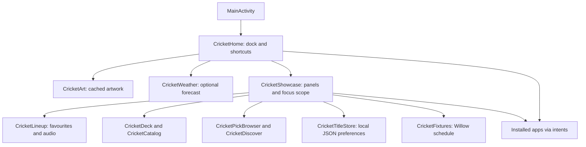

# Architecture and verification

Plain Java Android app, SDK 26+, target/compile SDK 34. AndroidX RecyclerView and DynamicAnimation are the runtime dependencies. No backend/server is required.



MainActivity activates the custom Home when bundled artwork exists. Active panels contain arrow focus within their descendants. Closing removes focusability before fading. Picker category changes commit immediately rather than in delayed animation callbacks. Favourites manages its own row geometry.

CricketTitleStore serializes title metadata in private SharedPreferences, deduplicating app package plus URL. Watch Later and custom categories have separate store names. A migration merges legacy cricket stores once. No runtime saved lists are exported.

## Network

The custom manifest includes INTERNET. CricketWeather requests Open-Meteo only after coordinates are configured. CricketFixtures fetches the public Willow schedule and caches parsed events in memory. No API keys are required for these endpoints. Title links launch provider apps; the launcher does not access their accounts.

Upstream network/Wi-Fi permissions support the network control. Location permission relates to Android's SSID access restrictions; weather does not use GPS to select a city. Existing remote helper services are optional and are not automatically authorized by building the app. No cross-app title-harvesting service is added.

## Checks

```sh
cd launcher
./gradlew --no-daemon testReleaseUnitTest lintRelease assembleRelease
```

From repository root: `python3 scripts/check_public_export.py`.

Original Python tests, device lists, and tools are retained. Some upstream assertions describe the original tiny offline launcher and are not applicable claims for this custom build. Upstream maintainer bots/workflows are excluded from this new repository.

Optional device navigation smoke test:

```sh
TV_SERIAL="<your connected test TV>" python3 tests/manual/test_navigation_on_tv.py
```

`ADB` can override the executable/arguments. This test requires an authorized TV and expected installed dock apps. It force-stops/restarts Home, injects keys, and checks focus across dock, top buttons, Shortcuts, Favourites, picker, Add more, and Watch Later. It does not disable packages or clear saved lists. Test physical remote behaviour separately; injected keys do not prove firmware-specific helper behaviour. Original customized runs used TCL Google TV / Android 12.
